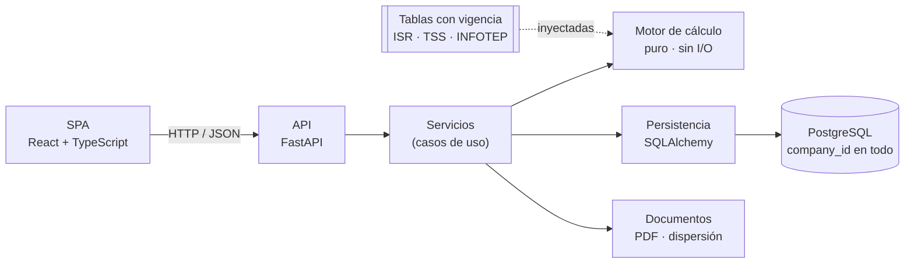

# Nómina RD — sistema de nómina multiempresa

> Proyecto de portafolio. Estado: **esqueleto inicial**. Las secciones marcadas _(por completar)_
> se llenarán a medida que avance el MVP.

## El problema

Una firma contable procesa la nómina de decenas de empresas cliente en República Dominicana. Cada
una tiene sus empleados, contratos y conceptos, pero todas comparten la misma normativa: ISR de la
DGII, aportes a la TSS (AFP, SFS, SRL) e INFOTEP. Esa normativa cambia con el tiempo. Un error de
un centavo, una tabla vencida o un dato mezclado entre empresas tiene consecuencias legales.

Este sistema:
- calcula la nómina con **precisión decimal exacta** y trazabilidad línea por línea;
- **reproduce** cualquier cálculo histórico con las tablas vigentes en su fecha;
- **aísla** los datos de cada empresa cliente;
- hace **inmutables** los periodos cerrados y deja **auditoría** completa.

## Arquitectura



_(por completar: modelo de datos y diagrama de estados del periodo)_

## Cómo correrlo

Requisitos: Python 3.12+, Node 20+, Docker (para PostgreSQL).

```bash
cp .env.example .env                 # completar contraseñas
docker compose up -d db

cd backend
python -m venv .venv && source .venv/bin/activate   # Windows: .venv\Scripts\activate
pip install -e ".[dev]"
alembic upgrade head
uvicorn nomina.api.main:app --reload # http://localhost:8000/docs

cd ../frontend
npm install
npm run dev                          # http://localhost:5173
```

Tests: `pytest` (backend) · `npm test` (frontend).

## Decisiones de diseño

| Decisión | Por qué |
|---|---|
| `Decimal` y `NUMERIC`, nunca `float` | Exactitud al centavo; el redondeo es explícito y ocurre una sola vez por línea. |
| Motor de cálculo puro | 100 % testeable con casos calculados a mano y property-based tests. |
| Tablas con `valid_from`/`valid_to` | Los cálculos históricos se pueden reproducir y auditar. |
| Periodo cerrado inmutable + ajustes | La misma práctica contable de no reescribir el pasado. |
| `company_id` en toda tabla e índice | Aislamiento multiempresa por diseño, no por disciplina. |

_(por completar: ADRs en `docs/decisiones/`)_

## Roadmap

_(por completar: enlace al tablero o issues)_

## Desarrollo asistido por IA

Las reglas del proyecto para agentes están en [AGENTS.md](AGENTS.md) y los procedimientos
repetibles, en [.claude/skills/](.claude/skills/).
